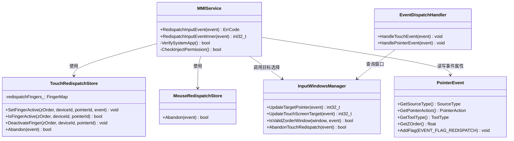
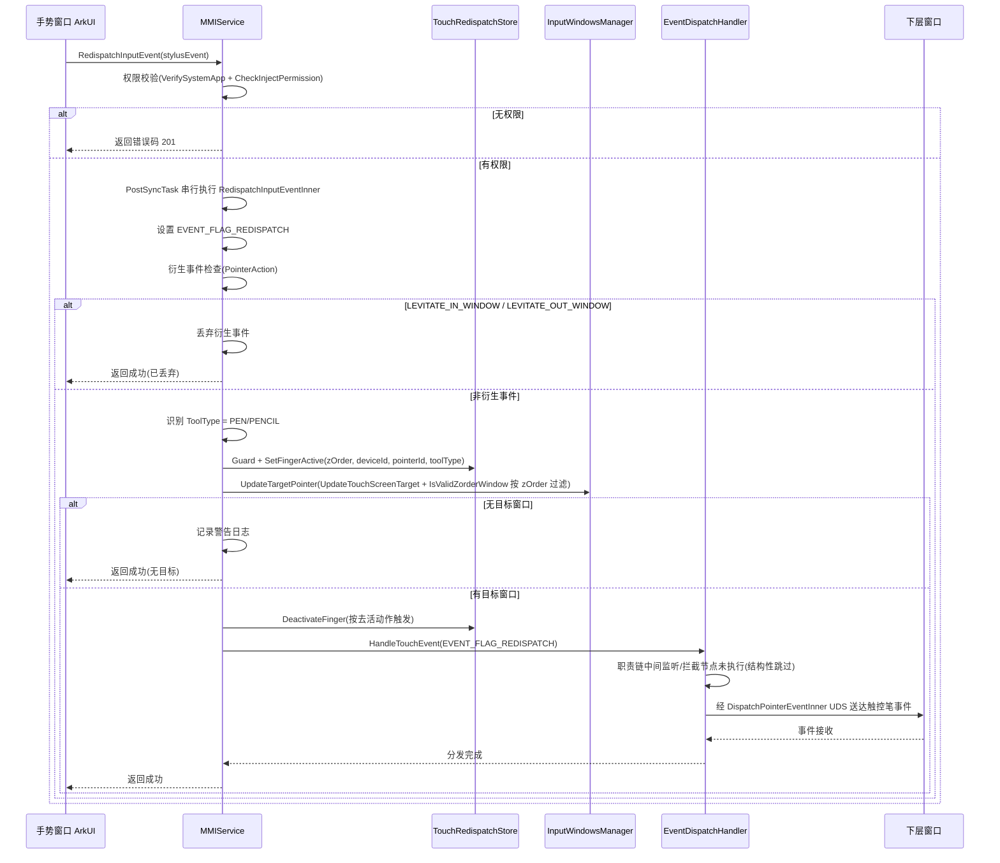

# Design

## 需求基线摘要

> 需求基线详见 proposal.md。以下仅列出设计阶段需额外强调的要点。

本变更在 multimodalinput_input 仓内，于现有 `RedispatchInputEvent` 内部接口基础上扩展触控笔（`TOOL_TYPE_PEN` / `TOOL_TYPE_PENCIL`）事件再分发能力。核心要点：触控笔事件走 `SOURCE_TYPE_TOUCHSCREEN` 分支，复用触屏再分发框架；`TouchRedispatchStore` 需按工具类型隔离触控笔和手指活跃状态；再分发路径丢弃进入/离开窗口衍生事件（`POINTER_ACTION_LEVITATE_IN_WINDOW` / `POINTER_ACTION_LEVITATE_OUT_WINDOW`）；再分发事件由输入事件职责链末端节点（EventDispatchHandler）进入分发，中间监听/拦截结构性不感知。选定方案A：在现有触屏分支中扩展触控笔支持（03-arch-decision-record.md §5）。遗留-1（状态隔离 key 设计）在本设计中确认：以 `(deviceId, pointerId, toolType)` 为 key。

## 代码事实基线

| 事实项 | 代码引用（文件:行） | 对设计的约束 |
|--------|-------------------|-------------|
| 再分发接口入口与权限校验 | service/module_loader/src/mmi_service.cpp:6371、6389-6396 | `RedispatchInputEvent` 已实现 VerifySystemApp + CheckInjectPermission（注入权限）校验，并经 `delegate_tasks_.PostSyncTask` 串行执行；触控笔再分发复用，不新增权限逻辑，不改签名 |
| 再分发内部实现入口 | service/module_loader/src/mmi_service.cpp:6322 | `RedispatchInputEventInner` 按 SourceType 分支处理再分发，触控笔扩展在此分支内增加 ToolType 识别 |
| EVENT_FLAG_REDISPATCH 标记设置 | service/module_loader/src/mmi_service.cpp:6325 | 再分发事件统一 `AddFlag(EVENT_FLAG_REDISPATCH)`，触控笔复用该标记 |
| 触屏再分发分支 | service/module_loader/src/mmi_service.cpp:6336-6351 | 已实现 `TouchRedispatchStore::Guard` → `WIN_MGR->UpdateTargetPointer` → `WIN_MGR->AbandonTouchRedispatch` → `eventDispatchHandler->HandleTouchEvent` 链路，触控笔在此分支内扩展 |
| 鼠标再分发分支 | service/module_loader/src/mmi_service.cpp:6352-6367 | 鼠标再分发（MouseRedispatchStore::Guard → UpdateTargetPointer → AbandonMouseRedispatch → HandlePointerEvent）已实现，触控笔扩展不可修改鼠标分支逻辑 |
| TouchRedispatchStore 活跃指针状态 | service/window_manager/include/touch_redispatch_store.h:81-103 | FingerMap 以 `zOrder → (deviceId, pointerId)` 两级 key 管理 `RedispatchFingerInfo`（SetFingerActive / IsFingerActive / DeactivateFinger / GetFingerEvent），需扩展 toolType 维度 |
| TouchRedispatchStore::Abandon | service/window_manager/src/touch_redispatch_store.cpp:161 | 触屏再分发放弃/去活判断入口，按 PointerAction 决定活跃与去活时机，触控笔场景在此扩展 |
| 窗口目标选择与 Z 序过滤 | service/window_manager/src/input_windows_manager.cpp:7072、5770、7934 | `UpdateTargetPointer` 按 SourceType 分发；`UpdateTouchScreenTarget` 选择触屏目标；`IsValidZorderWindow` 对 EVENT_FLAG_REDISPATCH 事件按 zOrder 过滤 Z 序之上窗口；复用该逻辑，验证触控笔场景 Z 序传递 |
| 末端分发处理 | service/event_dispatch/src/event_dispatch_handler.cpp | `EventDispatchHandler::HandleTouchEvent` 为分发链末端环节，再分发事件经此直达下层窗口 |
| 分发处理链构建 | service/event_handler/src/input_event_handler.cpp（BuildInputHandlerChain） | 正常链路 Normalize → ActiveSubscriber → Filter → Interceptor → 键盘/订阅节点（PreMonitor/KeyCommand/KeySubscriber） → Monitor → Hook → Dispatch；再分发事件由 RedispatchInputEventInner 直接调用末端 Dispatch 节点（event_dispatch_handler.cpp 的 HandleTouchEvent/HandlePointerEvent），中间节点结构性跳过（节点不执行、不感知） |

### 输入事件处理职责链与再分发进入位置

> 对应 spec US-5 的内部实现说明（AC 仅保留行为契约，实现细节归位于本节）。

输入事件职责链由 `InputEventHandler::BuildInputHandlerChain`（service/event_handler/src/input_event_handler.cpp）构建，触控/鼠标事件正常链路按序流经：

| 序号 | 职责链节点 | 职责 |
|------|-----------|------|
| 1 | EventNormalizeHandler | 事件归一化 |
| 2 | InputActiveSubscriberHandler | 活跃订阅 |
| 3 | EventFilterHandler | 事件过滤 |
| 4 | EventInterceptorHandler | 中间拦截 |
| 5 | EventPreMonitorHandler / KeyCommandHandler / KeySubscriberHandler | 组合键预处理/键指令/按键订阅（编译开关 OHOS_BUILD_ENABLE_KEYBOARD；对触控/鼠标事件承担手势识别） |
| 6 | EventMonitorHandler | 中间监听 |
| 7 | InputEventHookManager | 输入事件钩子 |
| 8 | EventDispatchHandler | 末端分发（经 DispatchPointerEventInner 通过 UDS 送达目标窗口会话） |

多模服务对再分发事件的处理节点位置：`RedispatchInputEvent`（service/module_loader/src/mmi_service.cpp，IPC 入口，IPC 线程执行 VerifySystemApp + CheckInjectPermission 权限校验）→ `delegateTasks_.PostSyncTask` 串行至 MMIService 事件线程 → `RedispatchInputEventInner`（设置 EVENT_FLAG_REDISPATCH、TouchRedispatchStore 状态管理、UpdateTargetPointer 目标选择、AbandonTouchRedispatch 放弃判断）→ 直接调用职责链末端节点 `EventDispatchHandler::HandleTouchEvent` / `HandlePointerEvent`（service/event_dispatch/src/event_dispatch_handler.cpp）。

因此再分发事件不进入职责链头部，而是从末端节点进入：节点 1~7 为结构性跳过（节点未被执行，非节点内检查标记），中间拦截（节点 4）与中间监听（节点 6）天然不感知。`EVENT_FLAG_REDISPATCH` 标记的消费位置在 `InputWindowsManager`（service/window_manager/src/input_windows_manager.cpp），用于目标选择与 Z 序过滤，不作为中间环节跳过依据。

## 设计约束

1. 触控笔事件走 `SOURCE_TYPE_TOUCHSCREEN` 分支，不可新增独立 SourceType
2. 不可修改鼠标再分发（`SOURCE_TYPE_MOUSE`）分支逻辑
3. 不可修改触屏手指事件再分发现有行为
4. 不可新增公开 API 或 System API
5. 权限校验复用现有注入权限 `ohos.permission.INJECT_INPUT_EVENT`，不新增权限
6. 再分发走独立标记路径（`EVENT_FLAG_REDISPATCH`），不影响正常输入事件分发性能
7. 衍生事件丢弃仅在再分发路径生效，正常分发路径的进入/离开窗口衍生事件（LEVITATE_IN_WINDOW / LEVITATE_OUT_WINDOW）不受影响

## 非目标

- 不设计 ArkUI 手势窗口的事件消费逻辑
- 不设计键盘事件再分发
- 不设计新增公开 API 的声明文件
- 不设计触控笔压力/倾斜等扩展属性的新增（仅再分发现有事件）

## 方案概述

选择在现有触屏再分发分支中扩展触控笔支持（方案A）。触控笔事件天然走 `SOURCE_TYPE_TOUCHSCREEN` 分支，仅需在 `RedispatchInputEventInner` 的触屏分支中增加 `ToolType` 识别逻辑，区分触控笔（`TOOL_TYPE_PEN` / `TOOL_TYPE_PENCIL`）和手指（`TOOL_TYPE_FINGER`）。`TouchRedispatchStore` 的 `FingerMap` 在 `zOrder → (deviceId, pointerId)` key 基础上扩展 `toolType` 维度（即 `(deviceId, pointerId, toolType)`），实现触控笔和手指活跃状态隔离。衍生事件丢弃逻辑在 `RedispatchInputEventInner` 入口处增加 `POINTER_ACTION_LEVITATE_IN_WINDOW` / `POINTER_ACTION_LEVITATE_OUT_WINDOW`（进入/离开窗口）检查，标记为再分发的事件直接丢弃。目标窗口选择复用 `InputWindowsManager` 的 Z 序目标选择与过滤逻辑（`UpdateTouchScreenTarget` + `IsValidZorderWindow`），按业务方指定 Z 序选择下一个可见窗口。再分发事件由 `EventDispatchHandler::HandleTouchEvent` 从职责链末端进入，中间监听/拦截环节结构性不感知；`EVENT_FLAG_REDISPATCH` 标记用于 `InputWindowsManager` 目标选择与 Z 序过滤。

## 架构图

```mermaid
graph TD
    A[多模输入服务 MMIService] -->|输入事件正常分发| B[窗口管理 InputWindowsManager]
    B -->|事件分发| C[事件分发处理 EventDispatchHandler]
    C -->|分发到手势窗口| D[手势窗口 ArkUI]
    D -->|未消费, 调用RedispatchInputEvent| A
    A -->|RedispatchInputEventInner 触控笔识别| E{衍生事件检查}
    E -->|LEVITATE_IN_WINDOW/LEVITATE_OUT_WINDOW| F[丢弃衍生事件]
    E -->|非衍生事件| G[TouchRedispatchStore 状态隔离]
    G -->|按toolType隔离活跃状态| H[按Z序选择目标窗口]
    H -->|InputWindowsManager| B
    B -->|再分发事件经末端分发节点进入(中间环节结构性跳过)| C
    C -->|DispatchPointerEventInner 经 UDS 送达| I[下层窗口]
```

## 类图



## 模块影响

> 基础影响范围见 proposal.md。以下仅列出设计阶段识别的新增/变更模块及对应的设计决策关联。

| 子系统 | 仓库 | 模块/路径 | 影响类型 | 相关设计决策 |
|--------|------|-----------|---------|-------------|
| 多模输入 | multimodalinput_input | service/module_loader/src/mmi_service.cpp | 修改 | DD-1（触控笔识别）、DD-2（衍生事件丢弃入口） |
| 多模输入 | multimodalinput_input | service/window_manager/include/touch_redispatch_store.h | 修改 | DD-3（状态隔离 key 设计） |
| 多模输入 | multimodalinput_input | service/window_manager/src/touch_redispatch_store.cpp | 修改 | DD-3（状态隔离 key 设计） |
| 多模输入 | multimodalinput_input | service/window_manager/include/input_windows_manager.h | 修改 | DD-4（目标选择方法声明） |
| 多模输入 | multimodalinput_input | service/window_manager/src/input_windows_manager.cpp | 修改 | DD-4（目标选择与 Z 序传递） |
| 多模输入 | multimodalinput_input | service/event_dispatch/ | 修改/验证 | DD-2（再分发事件经末端分发，验证中间环节不感知覆盖触控笔） |

## 实现入口

> 给执行 Agent 的代码接入点。优先引用现有入口、调用链和测试入口。

| Entry Point | 代码引用（文件:行） | 当前职责 | 调用方 | 被调用方 | 预期变更 |
|-------------|-------------------|----------|--------|----------|----------|
| RedispatchInputEvent | service/module_loader/src/mmi_service.cpp:6371 | 再分发接口入口，权限校验（VerifySystemApp/CheckInjectPermission），PostSyncTask 串行执行 | ArkUI 手势窗口（IPC 调用） | RedispatchInputEventInner | 无签名变更，验证权限覆盖触控笔 |
| RedispatchInputEventInner | service/module_loader/src/mmi_service.cpp:6322 | 设置 EVENT_FLAG_REDISPATCH，按 SourceType 分支处理再分发 | RedispatchInputEvent | TouchRedispatchStore、InputWindowsManager、EventDispatchHandler | 触屏分支增加触控笔 ToolType 识别和衍生事件丢弃 |
| TouchRedispatchStore::SetFingerActive / IsFingerActive / DeactivateFinger | service/window_manager/include/touch_redispatch_store.h:81-92 | 管理触屏活跃指针状态（zOrder → (deviceId, pointerId)） | RedispatchInputEventInner、Abandon | — | key 扩展加入 toolType 维度 |
| InputWindowsManager::UpdateTargetPointer / UpdateTouchScreenTarget / IsValidZorderWindow | service/window_manager/src/input_windows_manager.cpp:7072、5770、7934 | 再分发目标窗口选择与 Z 序过滤 | RedispatchInputEventInner | — | 复用现有逻辑，验证触控笔场景 Z 序传递 |
| EventDispatchHandler::HandleTouchEvent | service/event_dispatch/src/event_dispatch_handler.cpp | 事件分发到目标窗口（分发链末端环节） | RedispatchInputEventInner | — | 验证 EVENT_FLAG_REDISPATCH 事件中间环节不感知覆盖触控笔 |

## 既有模式复用

| Pattern | 参考代码（文件:行） | 复用方式 | 适用 Task |
|---------|-------------------|----------|-----------|
| 鼠标再分发分支模式 | service/module_loader/src/mmi_service.cpp:6352-6367 | 触控笔再分发参考鼠标分支的结构：权限检查 → 设置标记 → 状态管理 → 目标选择 → 分发 | TASK-2 |
| TouchRedispatchStore 活跃状态管理 | service/window_manager/include/touch_redispatch_store.h:81-103 | 复用 FingerMap 结构，扩展 key 加入 toolType 维度 | TASK-1 |
| 再分发事件末端分发进入模式 | service/module_loader/src/mmi_service.cpp（RedispatchInputEventInner 调用 EventDispatchHandler） | 触控笔再分发复用末端分发进入路径，中间环节结构性跳过，不新增标记 | TASK-4 |
| 权限校验模式 | service/module_loader/src/mmi_service.cpp:6389-6396 | 复用现有注入权限校验，不新增权限逻辑 | TASK-5 |
| 单元测试模式（gtest/HWTEST） | service/window_manager/test/、service/module_loader/test/ 现有测试（如 input_windows_manager_test.cpp、mmi_service_test.cpp） | 触控笔再分发测试参考现有窗口管理/服务测试结构 | TASK-1~TASK-5 |

## 关键设计决策

| 决策 ID | 问题 | 推荐方案 | 备选方案 | 选择理由 |
|---------|------|----------|----------|---------|
| DD-1 | 触控笔事件如何识别 | 在 RedispatchInputEventInner 触屏分支中通过 PointerEvent::GetToolType() 识别 TOOL_TYPE_PEN/TOOL_TYPE_PENCIL | 新增独立 SOURCE_TYPE_PEN 分支 | 触控笔事件天然走 SOURCE_TYPE_TOUCHSCREEN，新增 SourceType 需修改事件创建链路，改动大且不必要 |
| DD-2 | 衍生事件丢弃在哪里执行 | 在 RedispatchInputEventInner 入口处检查 PointerAction，LEVITATE_IN_WINDOW / LEVITATE_OUT_WINDOW 直接返回不进入分发 | 在 EventDispatchHandler 分发路径中过滤 | 入口处丢弃更早，避免无效的状态管理和目标选择开销；分发路径过滤需修改高频路径 |
| DD-3 | 触控笔与手指状态如何隔离 | TouchRedispatchStore 的 FingerMap key 在 zOrder → (deviceId, pointerId) 基础上扩展 toolType 维度（(deviceId, pointerId, toolType)） | 新增独立 StylusRedispatchStore | 复用现有结构，改动最小；独立 Store 代码冗余，维护成本高（03-arch-decision-record.md 已否决方案B） |
| DD-4 | 再分发目标窗口如何选择 | 复用 InputWindowsManager 的 Z 序目标选择与过滤逻辑（UpdateTouchScreenTarget + IsValidZorderWindow），按业务方指定 Z 序查找下一个可见窗口 | 新增独立目标选择逻辑 | Z 序查找逻辑已实现且经过验证，复用降低风险 |

## 状态归属与不变量

**Ownership（TouchRedispatchStore 活跃指针状态）**
- Owner: `TouchRedispatchStore`，key = `zOrder → (deviceId, pointerId, toolType)`（扩展后）
- 创建时机: `RedispatchInputEventInner` 触屏分支中 `SetFingerActive` 调用时
- 清理触发: `DeactivateFinger` 调用时（POINTER_ACTION_UP 或触控笔 PROXIMITY_OUT 等去活动作）
- 只读消费者: `RedispatchInputEventInner`（通过 `IsFingerActive` / `GetFingerEvent` 查询）
- 不变量: 同一 `(deviceId, pointerId, toolType)` 在 FingerMap 中最多存在一条活跃记录；不同 toolType 的记录互不影响
- 验证方法: 单元测试验证触控笔和手指同时活跃时状态隔离
- 关联 AC/Task: AC-1.1~AC-3.1, TASK-1

**Lifecycle（再分发事件生命周期）**
- 创建: `RedispatchInputEvent` 调用时拷贝创建再分发事件，`RedispatchInputEventInner` 中设置 `EVENT_FLAG_REDISPATCH`
- 清理: 事件分发到目标窗口后由 `EventDispatchHandler` 正常回收
- 异常恢复: 若目标窗口不存在（Z 序无目标），事件丢弃并记录警告日志
- 回滚触发: 无（再分发事件独立于正常分发，不影响原始事件链）
- 不变量: 再分发事件必须携带 `EVENT_FLAG_REDISPATCH` 标记；衍生事件（LEVITATE_IN_WINDOW / LEVITATE_OUT_WINDOW）在入口处丢弃不创建再分发实例
- 验证方法: 单元测试验证衍生事件丢弃和目标不存在时的处理
- 关联 AC/Task: AC-4.1, AC-4.2, TASK-2

**Concurrency（TouchRedispatchStore 线程安全）**
- 同步模型: `RedispatchInputEvent` 经 `delegate_tasks_.PostSyncTask` 将再分发处理串行化到 MMIService 事件线程执行；`TouchRedispatchStore::Guard` 在 `RedispatchInputEventInner` 触屏分支作用域内维护 `active_` / `zOrder_` 上下文
- 不变量: FingerMap 的读写均在服务事件线程完成，并发调用 RedispatchInputEvent 不会导致状态损坏
- 验证方法: 单元测试验证并发 AddActivePointer/RemoveActivePointer 等价路径（SetFingerActive/DeactivateFinger 交错调用）不产生数据竞争
- 关联 AC/Task: AC-1.1~AC-3.1, TASK-1

**Compatibility（兼容性约束）**
- 状态格式: FingerMap key 扩展加入 toolType 维度后，手指（TOOL_TYPE_FINGER）路径语义保持不变，旧数据无持久化故无迁移问题
- API: RedispatchInputEvent 签名不变，现有调用方无感知
- 默认行为: 鼠标和触屏手指再分发行为不变（运行时分支隔离）
- 不变量: 触控笔扩展仅在 ToolType=PEN/PENCIL 时触发，手指（FINGER）行为路径不变
- 验证方法: 回归测试验证鼠标和触屏手指再分发行为无变化
- 关联 AC/Task: AC-7.1~AC-7.3, TASK-5

## DFX 设计

### DFX 故障模式分析

| 分析对象 | 故障模式 | 故障影响 | 故障原因 | 严酷度 | 恢复措施 | 关键日志 | 大数据打点事件 | 来源 |
|---------|----------|----------|-------------|---------|---------|---------|---------|------|
| TouchRedispatchStore | 状态隔离失效导致触控笔和手指状态混淆 | 下层窗口收到错误事件序列 | key 未包含 toolType 维度 | 中 | 修复 key 设计，增加 toolType 维度 | Redispatch: toolType mismatch warning | redispatch_state_isolation_error | 02-feasibility.md §2.3 |
| RedispatchInputEventInner | 衍生事件未丢弃导致下层窗口收到冗余事件 | 下层窗口收到进入/离开窗口衍生事件（LEVITATE_IN_WINDOW / LEVITATE_OUT_WINDOW） | 衍生事件丢弃逻辑缺失 | 低 | 在入口处增加衍生事件检查 | Redispatch: derived event discarded | redispatch_derived_event_discarded | 01-requirement.md §7 |
| RedispatchInputEventInner | Z 序无目标窗口时再分发事件丢失 | 下层窗口未收到事件 | 业务方指定 Z 序下方无可见窗口 | 中 | 记录警告日志，返回成功（已处理但无目标） | Redispatch: no target window for zOrder | redispatch_no_target_window | 02-feasibility.md §2.3 |
| EventDispatchHandler | 再分发事件被中间监听感知 | 中间监听逻辑误触发 | EVENT_FLAG_REDISPATCH 跳过逻辑未覆盖触控笔 | 低 | 验证并修复 EVENT_FLAG_REDISPATCH 跳过路径 | Redispatch: middle listener skip failed | redispatch_middle_listener_skip | 01-requirement.md §7 |

### 关键 HiLog 日志（对应 spec US-1~US-5）

> 各 AC 关键实现路径对应的关键 HiLog 日志（完整 AC 级映射见 spec.md『关键 HiLog 日志』）。

| 实现路径 | 关键 HiLog 日志 | 来源 |
|---------|-----------|------|
| 触控笔接近自动激活 / 远离去活 | `Auto-activate pen on PROXIMITY_IN` / `Deactivate pen on PROXIMITY_OUT` | 现有（TouchRedispatchStore::Abandon） |
| 再分发事件末端分发进入 | `Redispatch, id:` / `source:` | 现有（RedispatchInputEventInner） |
| 真实手指同窗冲突放弃 | `Redispatch DOWN conflicts with real finger in same window` | 现有（RedispatchInputEventInner） |
| Z 序目标过滤 | `Skip the invalid zOrder window` | 现有（InputWindowsManager::DispatchTouch） |
| 悬停进出窗口衍生 | `Levitate in by horizon` / `Levitate out by horizon` / `Levitate in by Z-` / `Levitate out by Z+` | 现有（HandleLevitateInOutEvent） |
| 衍生事件入口丢弃 | `Redispatch: derived event discarded` | 规划（随本变更实现） |

## 安全基础检查

> 本节对涉及安全边界的变更进行基础安全检查。本次变更涉及注入权限校验（现有能力），需验证权限校验覆盖触控笔再分发场景。

### 信任边界交叉分析

| 交互类型 | 边界描述 | 通信双方 | 权限管控机制 | 关联 AC |
|---------|----------|----------|-------------|---------|
| 跨进程（IPC） | RedispatchInputEvent 为 IPC 接口，调用方（ArkUI 手势窗口进程）通过 IPC 调用 MMIService | ArkUI 手势窗口 → MMIService（多模输入服务进程） | ohos.permission.INJECT_INPUT_EVENT 注入权限校验（service/module_loader/src/mmi_service.cpp:6389-6396：VerifySystemApp + CheckInjectPermission） | AC-6.1, AC-6.2 |

### 基础安全要求检查

| 检查项 | 检查结果 | 说明/措施 |
|--------|----------|-----------|
| 加密算法合规 | N/A | 本次变更不涉及加密算法 |
| 密钥管理安全 | N/A | 本次变更不涉及密钥管理 |
| 随机数安全 | N/A | 本次变更不涉及随机数生成 |
| 输入验证完备 | ✅ | 再分发事件需验证 SourceType、ToolType、PointerAction 合法性；衍生事件（LEVITATE_IN_WINDOW / LEVITATE_OUT_WINDOW）在入口处丢弃 |
| 错误处理安全 | ✅ | 无权限时返回错误码 201，不泄露内部状态；无目标窗口时记录警告日志不含敏感信息 |
| 配置安全 | N/A | 本次变更不涉及配置文件 |

### 敏感数据处理（如适用）

本次变更不涉及敏感数据处理。再分发事件为输入事件坐标和工具类型，不含 PII、密钥、凭证或生物特征数据。

### 深度威胁分析（如需）

本次变更仅需上述基础检查，未触发深度威胁分析。理由：注入权限校验为现有能力（不新增权限逻辑），不涉及网络暴露面、认证授权变更或合规要求变更；再分发接口仅在单进程内（IPC 调用方需注入权限），无跨网络边界交互。

## 时序设计



## 风险与缓解

| 风险 | 可能性 | 影响 | 缓解措施 |
|------|--------|------|----------|
| 触控笔与手指事件状态混淆 | 中 | 下层窗口收到错误事件序列 | TouchRedispatchStore key 扩展为 (deviceId, pointerId, toolType)，单元测试验证隔离 |
| 衍生事件丢弃影响正常分发路径 | 低 | 正常分发路径的进入/离开窗口衍生事件（LEVITATE_IN_WINDOW / LEVITATE_OUT_WINDOW）被误丢 | 丢弃仅在 EVENT_FLAG_REDISPATCH 标记的再分发路径生效，正常路径不受影响 |
| Z 序传递不正确 | 低 | 再分发事件发到错误窗口 | 复用现有 UpdateTouchScreenTarget + IsValidZorderWindow 逻辑，单元测试验证 Z 序传递 |
| 再分发事件被中间监听感知 | 低 | 中间监听逻辑误触发 | 末端分发进入机制已实现（再分发事件从职责链末端节点进入），单元测试验证覆盖触控笔 |
| 触控笔高频再分发影响性能 | 低 | 输入事件分发延迟 | 再分发走独立标记路径，仅过滤检查，无全量扫描 |

## 验证思路

| 验证场景 | 方法 | 通过标准 |
|----------|------|----------|
| 触控笔接近事件再分发 | 单元测试 + 板侧功能测试 | 下层窗口收到触控笔接近事件（PROXIMITY_IN, PEN） |
| 触控笔远离事件再分发 | 单元测试 + 板侧功能测试 | 下层窗口收到触控笔远离事件（PROXIMITY_OUT, PEN） |
| 触控笔按下/移动/抬起事件再分发 | 单元测试 + 板侧功能测试 | 下层窗口收到完整触控笔按下/移动/抬起序列 |
| 触控笔悬停移动事件再分发 | 单元测试 + 板侧功能测试 | 下层窗口收到触控笔悬停移动事件 |
| 衍生事件丢弃 | 单元测试 | 进入/离开窗口衍生事件（LEVITATE_IN_WINDOW / LEVITATE_OUT_WINDOW）在再分发路径被丢弃 |
| 中间环节不感知 | 单元测试 + 板侧验证 | 中间监听/拦截回调未收到再分发事件 |
| 权限校验 | 单元测试 | 无权限返回错误码 201，有权限正常再分发 |
| 鼠标行为不变 | 回归测试 | 鼠标再分发行为无变化 |
| 触控笔手势行为不变 | 回归测试 | 触控笔形成手势事件正常触发 |
| 触控笔与手指状态隔离 | 单元测试 | 同时活跃时状态互不干扰 |
