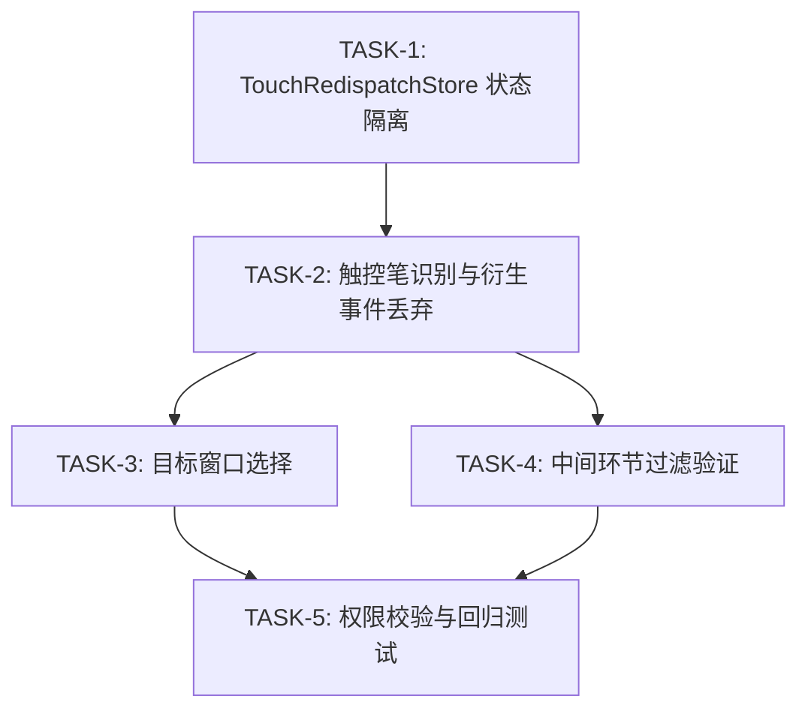

# Execution Plan

## 输入状态

| 输入 | 路径 | 要求状态 |
|------|------|----------|
| Proposal | proposal.md | Approved |
| Spec | spec.md | Approved |
| Design | design.md | Approved |

## 执行原则

- **Spec 权威：** 若实现细节与 `spec.md` 的 AC、错误码或兼容性声明冲突，先更新 spec/design，再继续实现。
- **测试/证据先行：** 每个 Task 先写失败测试；无法单测的集成行为必须先写明可复现证据缺口。
- **任务小型化：** 一个 Task 只覆盖一个独立闭环。跨 API、事件链、状态缓存、渲染链、生命周期的需求必须拆成多个 Task。
- **文件边界：** Task 只能修改 `Files` 表列出的文件；若构建暴露额外声明或 fixture 需求，先更新本计划。
- **状态所有权唯一：** 新增状态必须明确 owner、key/index、创建时机、清理触发和只读消费者。
- **证据回填：** Task 完成后必须回填本计划「AC 到 Task 追溯」验证状态、「代码范围映射」实际文件、per-task `Actual Result`。
- **反伪完成：** 只补声明、只写存储结构、只覆盖 happy path、只跑非相关测试，都不能替代 AC 闭环。
- **可交接执行（Agent 执行契约）：** 本计划须能被新 Agent 在无历史对话上下文下逐 Task 执行；执行契约由各 Task 结构承载——`只读上下文`/`Files`/`禁止修改文件`（上下文打包）、`Steps` 的 RED→GREEN（测试优先）、`Verification` 的 Expected/Actual（期望输出）、`Review Handoff`（评审交接）；每 Step 为含命令或代码方向的 2–5 分钟动作。

## AC 到 Task 追溯

| AC | 来源 | Task | 验证方式 | 验证状态（Pass/Fail/Blocked） |
|----|------|------|----------|----------------------------------|
| AC-1.1 | spec.md US-1 | TASK-1, TASK-2, TASK-3 | 单元测试 + 板侧功能测试 | Blocked |
| AC-1.2 | spec.md US-1 | TASK-1, TASK-2, TASK-3 | 单元测试 + 板侧功能测试 | Blocked |
| AC-2.1 | spec.md US-2 | TASK-1, TASK-2, TASK-3 | 单元测试 + 板侧功能测试 | Blocked |
| AC-2.2 | spec.md US-2 | TASK-1, TASK-2, TASK-3 | 单元测试 + 板侧功能测试 | Blocked |
| AC-2.3 | spec.md US-2 | TASK-1, TASK-2, TASK-3 | 单元测试 + 板侧功能测试 | Blocked |
| AC-3.1 | spec.md US-3 | TASK-1, TASK-2, TASK-3 | 单元测试 + 板侧功能测试 | Blocked |
| AC-4.1 | spec.md US-4 | TASK-2 | 单元测试 | Blocked |
| AC-4.2 | spec.md US-4 | TASK-2 | 单元测试 | Blocked |
| AC-5.1 | spec.md US-5 | TASK-4 | 单元测试 + 板侧验证 | Blocked |
| AC-5.2 | spec.md US-5 | TASK-4 | 单元测试 + 板侧验证 | Blocked |
| AC-6.1 | spec.md US-6 | TASK-5 | 单元测试 | Blocked |
| AC-6.2 | spec.md US-6 | TASK-5 | 单元测试 | Blocked |
| AC-7.1 | spec.md US-7 | TASK-5 | 回归测试 | Blocked |
| AC-7.2 | spec.md US-7 | TASK-5 | 回归测试 | Blocked |
| AC-7.3 | spec.md US-7 | TASK-5 | 回归测试 | Blocked |

## 实现边界

**必须实现：** TouchRedispatchStore 按 toolType 隔离状态、RedispatchInputEventInner 触控笔识别与衍生事件丢弃、InputWindowsManager 目标选择、EventDispatchHandler 中间环节过滤验证、权限校验验证与回归测试

**可后置：** 无

**不建议延后：** 衍生事件丢弃逻辑（AC-4.1/AC-4.2）——若延后，触控笔再分发主链不闭合，下层窗口会收到冗余衍生事件

## 禁止项

- 每个 AC 必须有明确的验证方式。
- Agent 不得自行寻找未列出的上下文文件作为修改依据；需要新增上下文时先更新 Task。
- 不得修改 Task 列出范围外的文件。
- 不得在未通过验证时标记 Task 完成。
- 不得使用 `TBD`、`TODO`、`适当处理`、`补充测试`、`参考上文` 等不可执行占位描述。
- 不得修改鼠标再分发（SOURCE_TYPE_MOUSE）分支逻辑。
- 不得修改触屏手指事件再分发现有行为路径。
- 不得新增公开 API 声明文件（.d.ts）。

## Task 依赖



## Task 列表

| TASK ID | 目标 | 文件范围 | AC 映射 | 前置依赖 | 完成判据 | 验证命令 | 状态 |
|---------|------|----------|---------|----------|----------|----------|------|
| TASK-1 | TouchRedispatchStore 按 toolType 隔离触控笔和手指活跃状态 | touch_redispatch_store.h, touch_redispatch_store.cpp, touch_redispatch_store_test.cpp | AC-1.1~AC-3.1（状态隔离） | 无 | 单元测试通过：触控笔和手指状态隔离验证 GREEN | `hb build --test` + 测试二进制执行 | Blocked |
| TASK-2 | RedispatchInputEventInner 触控笔 ToolType 识别与衍生事件丢弃 | mmi_service.cpp, redispatch_derived_event_test.cpp | AC-1.1~AC-3.1, AC-4.1, AC-4.2 | TASK-1 | 单元测试通过：触控笔事件被接受、衍生事件被丢弃 | `hb build --test` + 测试二进制执行 | Blocked |
| TASK-3 | InputWindowsManager 触控笔再分发目标选择与 Z 序传递 | input_windows_manager.h, input_windows_manager.cpp, redispatch_target_test.cpp | AC-1.1~AC-3.1（目标选择） | TASK-2 | 单元测试通过：按 Z 序选择目标窗口 | `hb build --test` + 测试二进制执行 | Blocked |
| TASK-4 | EventDispatchHandler 再分发事件中间环节过滤验证 | event_dispatch_handler.cpp（按需）, redispatch_visibility_test.cpp | AC-5.1, AC-5.2 | TASK-2 | 单元测试通过：中间监听/拦截不感知再分发事件 | `hb build --test` + 测试二进制执行 | Blocked |
| TASK-5 | 权限校验验证与回归测试 | redispatch_permission_test.cpp, mouse_redispatch_regression_test.cpp | AC-6.1, AC-6.2, AC-7.1~AC-7.3 | TASK-1, TASK-2, TASK-3, TASK-4 | 单元测试与回归测试通过 | 权限测试仅 UT：`hb build --test` + 测试二进制执行；回归测试：`hb build --test` + hdc 板侧测试执行 | Blocked |

## Task 详情

### TASK-1: TouchRedispatchStore 按 toolType 隔离触控笔和手指活跃状态

**目标：** 扩展 TouchRedispatchStore 的 FingerMap key 从 `zOrder → (deviceId, pointerId)` 扩展加入 toolType 维度（`zOrder → (deviceId, pointerId, toolType)`），实现触控笔和手指活跃状态隔离管理。

**AC 映射：** AC-1.1, AC-1.2, AC-2.1, AC-2.2, AC-2.3, AC-3.1（状态隔离基础）

**前置依赖：** 无

**非目标：** 不修改 RedispatchInputEventInner 逻辑（TASK-2）；不修改 InputWindowsManager（TASK-3）

**状态所有权：** Owner: TouchRedispatchStore；key = zOrder → (deviceId, pointerId, toolType)；创建时机: SetFingerActive 调用；清理触发: DeactivateFinger 调用；只读消费者: RedispatchInputEventInner（IsFingerActive/GetFingerEvent）

**任务间接口：** Produces=TouchRedispatchStore 的 SetFingerActive/IsFingerActive/DeactivateFinger/GetFingerEvent/GetFingerWindowId 接受 toolType 参数；Consumes=无

**只读上下文**

| 路径 | 读取目的 |
|------|----------|
| service/window_manager/include/touch_redispatch_store.h | 了解现有 FingerMap 结构和 key 设计（touch_redispatch_store.h:81-103） |
| service/window_manager/src/touch_redispatch_store.cpp | 了解现有 SetFingerActive/DeactivateFinger/IsFingerActive/Abandon 实现 |

**Files**

| 操作 | 文件 | 说明 |
|------|------|------|
| 修改 | service/window_manager/include/touch_redispatch_store.h | FingerMap key 结构扩展为 (deviceId, pointerId, toolType)，SetFingerActive 等方法签名增加 toolType 参数 |
| 修改 | service/window_manager/src/touch_redispatch_store.cpp | FingerMap 查找适配新 key，SetFingerActive/DeactivateFinger/IsFingerActive 等方法适配 toolType 参数 |
| 新增 | service/window_manager/test/touch_redispatch_store_test.cpp | 触控笔和手指状态隔离单元测试 |

**禁止修改文件**

| 文件/路径 | 原因 |
|-----------|------|
| service/module_loader/src/mmi_service.cpp | TASK-2 范围 |
| service/window_manager/include/mouse_redispatch_store.h | 鼠标再分发不受影响 |
| service/event_dispatch/ | TASK-4 范围 |

**Steps**

- [ ] Step 1: 写失败测试，验证触控笔和手指活跃状态隔离。

```text
测试名称：TouchRedispatchStoreStylusFingerIsolation
测试输入：构造 deviceId=1, pointerId=0 的触控笔事件（TOOL_TYPE_PEN）和手指事件（TOOL_TYPE_FINGER），分别调用 SetFingerActive
断言重点：IsFingerActive(zOrder, 1, 0, TOOL_TYPE_PEN) 返回 true，IsFingerActive(zOrder, 1, 0, TOOL_TYPE_FINGER) 返回 true，两者互不影响；DeactivateFinger(zOrder, 1, 0, TOOL_TYPE_PEN) 后 IsFingerActive(zOrder, 1, 0, TOOL_TYPE_FINGER) 仍返回 true
```

- [ ] Step 2: 运行验证，确认 RED。

```bash
hb build --test && hdc shell "/data/local/tmp/touch_redispatch_store_test"
```

Expected: 测试失败——现有 FingerMap key 不含 toolType，触控笔和手指状态互相覆盖，IsFingerActive 无法区分

- [ ] Step 3: 做最小实现。

```text
在 touch_redispatch_store.h 中：1) FingerMap 内层 key 结构扩展为包含 deviceId、pointerId、toolType 三个字段；2) SetFingerActive/IsFingerActive/DeactivateFinger/GetFingerEvent/GetFingerWindowId 签名增加 ToolType toolType 参数。在 touch_redispatch_store.cpp 中：1) 适配新 key 构造与查找；2) SetFingerActive/DeactivateFinger/IsFingerActive 等方法按新 key 操作 redispatchFingers_
```

- [ ] Step 4: 运行聚焦验证，确认 GREEN。

```bash
hb build --test && hdc shell "/data/local/tmp/touch_redispatch_store_test"
```

Expected: 测试通过——触控笔和手指活跃状态隔离验证成功

- [ ] Step 5: 如有必要，在保持 GREEN 的前提下重构。
- [ ] 回填本计划「AC 到 Task 追溯」验证状态、「代码范围映射」实际文件、per-task Actual Result。
- [ ] 回填本 Task 的 `Actual Result`。

**Anti-Fake Completion**

| Check | Required Evidence |
|-------|-------------------|
| AC closed | 单元测试证明触控笔和手指同时活跃时状态互不干扰（AC-1.1~AC-3.1 状态隔离基础） |
| Scope respected | 仅修改 touch_redispatch_store.h/.cpp 和测试文件 |
| State lifecycle complete | SetFingerActive（创建）→ IsFingerActive（读取）→ DeactivateFinger（清理）均覆盖 |

**Verification**

| Command / Evidence | Expected Result | Actual Result |
|--------------------|-----------------|---------------|
| hb build --test + touch_redispatch_store_test | 触控笔和手指状态隔离测试通过 | 待回填 |

**Review Handoff**

| Reviewer | Input |
|----------|-------|
| Spec Compliance | AC-1.1~AC-3.1 状态隔离基础覆盖、文件范围 touch_redispatch_store.h/.cpp、验证证据单元测试、无额外行为 |
| Code Quality | FingerMap key 扩展为三元素、与现有事件线程串行模型一致、测试通过、Base/Head SHA 待回填 |

### TASK-2: RedispatchInputEventInner 触控笔识别与衍生事件丢弃

**目标：** 在 RedispatchInputEventInner 触屏分支中增加触控笔 ToolType 识别（TOOL_TYPE_PEN/TOOL_TYPE_PENCIL），并在入口处丢弃进入/离开窗口衍生事件（POINTER_ACTION_LEVITATE_IN_WINDOW / POINTER_ACTION_LEVITATE_OUT_WINDOW）。

**AC 映射：** AC-1.1, AC-1.2, AC-2.1, AC-2.2, AC-2.3, AC-3.1, AC-4.1, AC-4.2

**前置依赖：** TASK-1（TouchRedispatchStore 已支持 toolType 隔离）

**非目标：** 不修改目标窗口选择逻辑（TASK-3）；不修改中间环节过滤（TASK-4）

**状态所有权：** 无新增状态。复用 TASK-1 的 TouchRedispatchStore 状态管理

**任务间接口：** Produces=RedispatchInputEventInner 触屏分支接受 TOOL_TYPE_PEN/PENCIL 事件并调用 TouchRedispatchStore::SetFingerActive 时传入 toolType；丢弃 POINTER_ACTION_LEVITATE_IN_WINDOW / POINTER_ACTION_LEVITATE_OUT_WINDOW 衍生事件。Consumes=TouchRedispatchStore::SetFingerActive/IsFingerActive（来自 TASK-1）

**只读上下文**

| 路径 | 读取目的 |
|------|----------|
| service/module_loader/src/mmi_service.cpp:6322-6351 | 了解现有 RedispatchInputEventInner 和触屏再分发分支结构 |
| service/module_loader/src/mmi_service.cpp:6371-6397 | 了解 RedispatchInputEvent 入口与权限校验 |
| service/window_manager/include/touch_redispatch_store.h | 了解 TASK-1 扩展后的接口签名 |

**Files**

| 操作 | 文件 | 说明 |
|------|------|------|
| 修改 | service/module_loader/src/mmi_service.cpp | RedispatchInputEventInner 触屏分支增加 ToolType 识别和衍生事件丢弃 |
| 新增 | service/module_loader/test/redispatch_derived_event_test.cpp | 衍生事件丢弃单元测试 |
| 修改 | service/module_loader/test/mmi_service_test.cpp | 增加触控笔事件再分发接受测试 |

**禁止修改文件**

| 文件/路径 | 原因 |
|-----------|------|
| service/window_manager/include/touch_redispatch_store.h | TASK-1 范围（已完成） |
| service/window_manager/src/touch_redispatch_store.cpp | TASK-1 范围（已完成） |
| service/window_manager/include/input_windows_manager.h | TASK-3 范围 |
| service/event_dispatch/ | TASK-4 范围 |

**Steps**

- [ ] Step 1: 写失败测试，验证衍生事件丢弃和触控笔事件接受。

```text
测试名称 1：DiscardLevitateInWindowOnRedispatch
测试输入：构造 PointerAction=POINTER_ACTION_LEVITATE_IN_WINDOW 的事件，设置 EVENT_FLAG_REDISPATCH，调用 RedispatchInputEventInner
断言重点：事件被丢弃，不进入目标选择和分发流程，返回成功

测试名称 2：DiscardLevitateOutWindowOnRedispatch
测试输入：构造 PointerAction=POINTER_ACTION_LEVITATE_OUT_WINDOW 的事件，设置 EVENT_FLAG_REDISPATCH，调用 RedispatchInputEventInner
断言重点：事件被丢弃，不进入目标选择和分发流程

测试名称 3：RedispatchStylusDownAccepted
测试输入：构造 PointerAction=DOWN, ToolType=TOOL_TYPE_PEN 的事件，调用 RedispatchInputEventInner
断言重点：事件被接受进入再分发流程，TouchRedispatchStore::IsFingerActive 返回 true
```

- [ ] Step 2: 运行验证，确认 RED。

```bash
hb build --test && hdc shell "/data/local/tmp/redispatch_derived_event_test" "/data/local/tmp/mmi_service_test"
```

Expected: 测试失败——现有触屏分支不识别 TOOL_TYPE_PEN 的隔离状态，不丢弃 LEVITATE_IN_WINDOW/LEVITATE_OUT_WINDOW

- [ ] Step 3: 做最小实现。

```text
在 mmi_service.cpp RedispatchInputEventInner 中：1) 在触屏分支入口处增加衍生事件检查：if (PointerAction == POINTER_ACTION_LEVITATE_IN_WINDOW || PointerAction == POINTER_ACTION_LEVITATE_OUT_WINDOW) && EVENT_FLAG_REDISPATCH 已设置，则 return RET_OK（丢弃）；2) 在触屏分支处理中增加 ToolType 识别：获取 PointerEvent::GetToolType()，当为 TOOL_TYPE_PEN 或 TOOL_TYPE_PENCIL 时，调用 TouchRedispatchStore::SetFingerActive 时传入 toolType 参数；3) 确保 TOOL_TYPE_FINGER 路径行为不变
```

- [ ] Step 4: 运行聚焦验证，确认 GREEN。

```bash
hb build --test && hdc shell "/data/local/tmp/redispatch_derived_event_test" "/data/local/tmp/mmi_service_test"
```

Expected: 衍生事件丢弃测试通过、触控笔事件接受测试通过

- [ ] Step 5: 如有必要，在保持 GREEN 的前提下重构。
- [ ] 回填本计划「AC 到 Task 追溯」验证状态、「代码范围映射」实际文件、per-task Actual Result。
- [ ] 回填本 Task 的 `Actual Result`。

**Anti-Fake Completion**

| Check | Required Evidence |
|-------|-------------------|
| AC closed | 单元测试证明 LEVITATE_IN_WINDOW/LEVITATE_OUT_WINDOW 丢弃（AC-4.1/AC-4.2）、触控笔事件被接受（AC-1.1~AC-3.1）、正常路径衍生事件不受影响 |
| Scope respected | 仅修改 mmi_service.cpp 和测试文件 |
| State lifecycle complete | N/A（无新增状态，复用 TASK-1 状态管理） |

**Verification**

| Command / Evidence | Expected Result | Actual Result |
|--------------------|-----------------|---------------|
| hb build --test + redispatch_derived_event_test | 衍生事件丢弃测试通过 | 待回填 |
| hb build --test + mmi_service_test | 触控笔事件接受测试通过 | 待回填 |

**Review Handoff**

| Reviewer | Input |
|----------|-------|
| Spec Compliance | AC-1.1~AC-3.1（触控笔接受）、AC-4.1/AC-4.2（衍生事件丢弃）覆盖、文件范围 mmi_service.cpp、验证证据单元测试、无修改鼠标分支 |
| Code Quality | 衍生事件检查在入口处、ToolType 识别在触屏分支内、手指路径不变、测试通过、Base/Head SHA 待回填 |

### TASK-3: InputWindowsManager 触控笔再分发目标选择与 Z 序传递

**目标：** 在 InputWindowsManager 中确保触控笔再分发按业务方指定 Z 序选择目标窗口，复用现有 UpdateTouchScreenTarget + IsValidZorderWindow 逻辑并验证 Z 序传递正确。

**AC 映射：** AC-1.1, AC-1.2, AC-2.1, AC-2.2, AC-2.3, AC-3.1（目标选择）

**前置依赖：** TASK-2（RedispatchInputEventInner 已接受触控笔事件）

**非目标：** 不修改中间环节过滤（TASK-4）；不修改权限校验（TASK-5）

**状态所有权：** 无新增状态

**任务间接口：** Produces=InputWindowsManager 触控笔再分发目标选择（复用 UpdateTouchScreenTarget + IsValidZorderWindow，验证 Z 序传递）；Consumes=RedispatchInputEventInner 触控笔事件（来自 TASK-2）

**只读上下文**

| 路径 | 读取目的 |
|------|----------|
| service/window_manager/include/input_windows_manager.h | 了解现有 UpdateTargetPointer/UpdateTouchScreenTarget 方法签名和窗口查找逻辑 |
| service/window_manager/src/input_windows_manager.cpp:5770、7072、7934 | 了解现有目标选择与 Z 序过滤实现 |
| service/module_loader/src/mmi_service.cpp:6336-6351 | 了解现有触屏再分发如何调用目标选择 |

**Files**

| 操作 | 文件 | 说明 |
|------|------|------|
| 修改 | service/window_manager/include/input_windows_manager.h | 如需新增触控笔再分发目标选择方法声明 |
| 修改 | service/window_manager/src/input_windows_manager.cpp | 触控笔再分发目标选择与 Z 序传递验证 |
| 新增 | service/window_manager/test/redispatch_target_test.cpp | 目标选择单元测试 |

**禁止修改文件**

| 文件/路径 | 原因 |
|-----------|------|
| service/module_loader/src/mmi_service.cpp | TASK-2 范围（已完成） |
| service/window_manager/include/touch_redispatch_store.h | TASK-1 范围（已完成） |
| service/event_dispatch/ | TASK-4 范围 |

**Steps**

- [ ] Step 1: 写失败测试，验证按 Z 序选择目标窗口。

```text
测试名称：RedispatchStylusTargetSelectionByZOrder
测试输入：构造两个窗口（Z 序 1.0 和 Z 序 0.5），触控笔事件指定 Z 序 1.0，调用再分发
断言重点：目标窗口为 Z 序 1.0 下方的 Z 序 0.5 窗口，事件分发到该窗口

测试名称：RedispatchStylusNoTargetWindow
测试输入：构造单个窗口（Z 序 1.0），触控笔事件指定 Z 序 1.0，调用再分发
断言重点：Z 序下方无可见窗口，事件丢弃，返回成功（已处理但无目标），记录警告日志
```

- [ ] Step 2: 运行验证，确认 RED。

```bash
hb build --test && hdc shell "/data/local/tmp/redispatch_target_test"
```

Expected: 测试失败——现有目标选择未验证触控笔场景，或 Z 序传递在触控笔路径不正确

- [ ] Step 3: 做最小实现。

```text
在 input_windows_manager.cpp 中：1) 验证 UpdateTouchScreenTarget 在触控笔再分发场景下正确返回目标窗口；2) 如需新增方法，在 input_windows_manager.h 声明 SelectRedispatchTarget(float zOrder) 方法，在 input_windows_manager.cpp 实现：遍历窗口列表，选择 Z 序小于指定 zOrder 的最大 Z 序可见窗口；3) 在 RedispatchInputEventInner 调用目标选择时传入 PointerEvent::GetZOrder() 获取的 Z 序
```

- [ ] Step 4: 运行聚焦验证，确认 GREEN。

```bash
hb build --test && hdc shell "/data/local/tmp/redispatch_target_test"
```

Expected: 目标选择测试通过——按 Z 序正确选择目标窗口，无目标时正确处理

- [ ] Step 5: 如有必要，在保持 GREEN 的前提下重构。
- [ ] 回填本计划「AC 到 Task 追溯」验证状态、「代码范围映射」实际文件、per-task Actual Result。
- [ ] 回填本 Task 的 `Actual Result`。

**Anti-Fake Completion**

| Check | Required Evidence |
|-------|-------------------|
| AC closed | 单元测试证明按 Z 序选择目标窗口（AC-1.1~AC-3.1 目标选择）、无目标时正确丢弃 |
| Scope respected | 仅修改 input_windows_manager.h/.cpp 和测试文件 |
| State lifecycle complete | N/A（无新增状态） |

**Verification**

| Command / Evidence | Expected Result | Actual Result |
|--------------------|-----------------|---------------|
| hb build --test + redispatch_target_test | 目标选择测试通过 | 待回填 |

**Review Handoff**

| Reviewer | Input |
|----------|-------|
| Spec Compliance | AC-1.1~AC-3.1 目标选择覆盖、文件范围 input_windows_manager.h/.cpp、验证证据单元测试、无修改 RedispatchInputEvent 签名 |
| Code Quality | 复用 UpdateTouchScreenTarget + IsValidZorderWindow、无目标时警告日志、Z 序传递正确、测试通过、Base/Head SHA 待回填 |

### TASK-4: EventDispatchHandler 再分发事件中间环节过滤验证

**目标：** 验证再分发事件由 MMIService 从输入事件职责链末端节点（EventDispatchHandler）进入分发，中间监听（EventMonitorHandler）/中间拦截（EventInterceptorHandler）结构性跳过（节点未执行），目标窗口正常收到事件。

**AC 映射：** AC-5.1, AC-5.2

**前置依赖：** TASK-2（RedispatchInputEventInner 已设置 EVENT_FLAG_REDISPATCH 并接受触控笔事件）

**非目标：** 不修改目标选择逻辑（TASK-3）；不修改权限校验（TASK-5）

**状态所有权：** 无新增状态

**任务间接口：** Produces=验证中间监听/拦截结构性跳过覆盖触控笔再分发事件；Consumes=RedispatchInputEventInner 末端分发调用与 EVENT_FLAG_REDISPATCH 标记（来自 TASK-2）

**只读上下文**

| 路径 | 读取目的 |
|------|----------|
| service/event_dispatch/src/event_dispatch_handler.cpp | 了解再分发事件经 HandleTouchEvent 末端分发的实现 |
| service/event_handler/src/input_event_handler.cpp:395-434 | 了解分发处理链构建：Normalize → Filter → Interceptor → … → Monitor → Hook → Dispatch |
| service/module_loader/src/mmi_service.cpp:6325 | 了解 EVENT_FLAG_REDISPATCH 标记设置方式 |

**Files**

| 操作 | 文件 | 说明 |
|------|------|------|
| 修改 | service/event_dispatch/src/event_dispatch_handler.cpp | 如需扩展再分发事件跳过中间环节逻辑覆盖触控笔事件类型（仅在验证发现缺口时） |
| 新增 | service/event_dispatch/test/redispatch_visibility_test.cpp | 中间环节不感知单元测试 |

**禁止修改文件**

| 文件/路径 | 原因 |
|-----------|------|
| service/module_loader/src/mmi_service.cpp | TASK-2 范围（已完成） |
| service/window_manager/include/touch_redispatch_store.h | TASK-1 范围（已完成） |
| service/window_manager/include/input_windows_manager.h | TASK-3 范围（已完成） |

**Steps**

- [ ] Step 1: 写失败测试，验证中间监听/拦截不感知再分发事件。

```text
测试名称 1：MiddleListenerNotNotifiedOnStylusRedispatch
测试输入：注册中间监听（InputMonitor），构造触控笔事件设置 EVENT_FLAG_REDISPATCH，经 EventDispatchHandler 分发
断言重点：中间监听回调未被调用

测试名称 2：MiddleInterceptorNotNotifiedOnStylusRedispatch
测试输入：注册中间拦截（InputInterceptor），构造触控笔事件设置 EVENT_FLAG_REDISPATCH，经 EventDispatchHandler 分发
断言重点：中间拦截回调未被调用，目标窗口正常收到事件
```

- [ ] Step 2: 运行验证，确认 RED 或验证现状。

```bash
hb build --test && hdc shell "/data/local/tmp/redispatch_visibility_test"
```

Expected: 测试可能通过（再分发事件从职责链末端节点进入，中间环节结构性不感知）或失败（触控笔再分发未走末端分发路径）——若通过则验证覆盖即可，若失败则需修复

- [ ] Step 3: 做最小实现（如需）。

```text
在 event_dispatch_handler.cpp 中：1) 验证再分发事件（EVENT_FLAG_REDISPATCH）经 HandleTouchEvent 分发时不经过 EventFilter/Interceptor/PreMonitor/Monitor/Hook 环节；2) 若发现中间环节可感知再分发事件，检查 RedispatchInputEventInner 是否误将事件送入职责链头部并修正为从末端分发节点进入（确保触控笔走 SOURCE_TYPE_TOUCHSCREEN 分支同样被覆盖）；3) 验证末端分发节点经 DispatchPointerEventInner 将事件送达目标窗口，目标窗口正常接收
```

- [ ] Step 4: 运行聚焦验证，确认 GREEN。

```bash
hb build --test && hdc shell "/data/local/tmp/redispatch_visibility_test"
```

Expected: 中间监听/拦截不感知测试通过——中间环节结构性跳过验证成功，目标窗口正常收到事件

- [ ] Step 5: 如有必要，在保持 GREEN 的前提下重构。
- [ ] 回填本计划「AC 到 Task 追溯」验证状态、「代码范围映射」实际文件、per-task Actual Result。
- [ ] 回填本 Task 的 `Actual Result`。

**Anti-Fake Completion**

| Check | Required Evidence |
|-------|-------------------|
| AC closed | 单元测试证明中间监听不感知（AC-5.1）、中间拦截不感知且目标窗口正常收到（AC-5.2） |
| Scope respected | 仅修改 event_dispatch/ 和测试文件 |
| State lifecycle complete | N/A（无新增状态） |

**Verification**

| Command / Evidence | Expected Result | Actual Result |
|--------------------|-----------------|---------------|
| hb build --test + redispatch_visibility_test | 中间环节不感知测试通过 | 待回填 |

**Review Handoff**

| Reviewer | Input |
|----------|-------|
| Spec Compliance | AC-5.1/AC-5.2 覆盖、文件范围 event_dispatch/、验证证据单元测试、目标窗口正常收到事件 |
| Code Quality | 复用现有末端分发进入机制、不新增标记、测试通过、Base/Head SHA 待回填 |

### TASK-5: 权限校验验证与回归测试

**目标：** 验证 RedispatchInputEvent 权限校验覆盖触控笔再分发场景（无权限返回错误码 201）。权限校验仅 UT 覆盖——正式版本中无法构建无权限场景进行板侧验收，通过 UT 模拟（mock）调用方权限状态验证；并执行回归测试确保鼠标和触屏手指再分发现有行为不变。

**AC 映射：** AC-6.1, AC-6.2, AC-7.1, AC-7.2, AC-7.3

**前置依赖：** TASK-1, TASK-2, TASK-3, TASK-4（全部触控笔再分发逻辑已完成）

**非目标：** 不新增权限逻辑（复用现有注入权限校验）；不修改触控笔再分发核心逻辑

**状态所有权：** 无新增状态

**任务间接口：** Produces=权限校验覆盖触控笔场景的验证证据、回归测试通过证据；Consumes=RedispatchInputEvent 权限校验入口（现有）、全部触控笔再分发逻辑（来自 TASK-1~TASK-4）

**只读上下文**

| 路径 | 读取目的 |
|------|----------|
| service/module_loader/src/mmi_service.cpp:6371-6397 | 了解现有权限校验入口（VerifySystemApp + CheckInjectPermission）和错误返回方式 |
| service/module_loader/test/、service/window_manager/test/ 目录现有权限和回归测试 | 了解现有测试模式 |

**Files**

| 操作 | 文件 | 说明 |
|------|------|------|
| 新增 | service/module_loader/test/redispatch_permission_test.cpp | 权限校验单元测试 |
| 新增 | service/window_manager/test/mouse_redispatch_regression_test.cpp | 鼠标再分发回归测试 |

**禁止修改文件**

| 文件/路径 | 原因 |
|-----------|------|
| service/module_loader/src/mmi_service.cpp | 权限校验为现有能力，不修改核心逻辑 |
| service/window_manager/include/touch_redispatch_store.h | TASK-1 范围（已完成） |
| service/event_dispatch/ | TASK-4 范围（已完成） |

**Steps**

- [ ] Step 1: 写失败测试，验证权限校验和回归行为。

```text
测试名称 1：PermissionDeniedWithoutInjectPermission
测试输入：UT 模拟（mock）无 ohos.permission.INJECT_INPUT_EVENT 权限的调用方，调用 RedispatchInputEvent 归还触控笔事件（正式版本无法构建板侧无权限场景，仅 UT 覆盖）
断言重点：返回错误码 201，事件不进入再分发流程

测试名称 2：PermissionGrantedWithInjectPermission
测试输入：UT 模拟（mock）有 ohos.permission.INJECT_INPUT_EVENT 权限的调用方，调用 RedispatchInputEvent 归还触控笔事件
断言重点：权限校验通过，事件正常进入再分发流程

测试名称 3：MouseGestureUnchanged
测试输入：鼠标形成手势事件分发到手势窗口
断言重点：鼠标手势正常触发，行为无变化

测试名称 4：StylusGestureUnchanged
测试输入：触控笔形成手势事件分发到手势窗口
断言重点：触控笔手势正常触发，行为无变化

测试名称 5：MouseRedispatchUnchanged
测试输入：鼠标未消费事件调用 RedispatchInputEvent 归还
断言重点：下层窗口收到完整鼠标按下/移动/抬起/滚轮序列，行为无变化
```

- [ ] Step 2: 运行验证，确认 RED 或验证现状。

```bash
hb build --test && hdc shell "/data/local/tmp/redispatch_permission_test" "/data/local/tmp/mouse_redispatch_regression_test"
```

Expected: 权限测试可能通过（现有校验已覆盖触控笔，UT mock 验证，不依赖板侧场景）或失败（需验证覆盖）；回归测试应通过（现有行为不变）——若权限测试失败则需修复权限校验覆盖

- [ ] Step 3: 做最小实现（如需）。

```text
权限校验为现有能力（service/module_loader/src/mmi_service.cpp:6389-6396），若测试发现触控笔场景未覆盖：在权限校验入口确认校验在 SourceType 和 ToolType 检查之前执行，确保所有事件类型（包括触控笔）都经过权限校验。回归测试无需修改代码，仅验证现有行为不受 TASK-1~TASK-4 变更影响
```

- [ ] Step 4: 运行聚焦验证，确认 GREEN。

```bash
hb build --test && hdc shell "/data/local/tmp/redispatch_permission_test" "/data/local/tmp/mouse_redispatch_regression_test"
```

Expected: 权限校验测试通过（无权限返回 201、有权限正常再分发）、回归测试通过（鼠标和触控笔手势行为不变、鼠标再分发行为不变）

- [ ] Step 5: 如有必要，在保持 GREEN 的前提下重构。
- [ ] 回填本计划「AC 到 Task 追溯」验证状态、「代码范围映射」实际文件、per-task Actual Result。
- [ ] 回填本 Task 的 `Actual Result`。

**Anti-Fake Completion**

| Check | Required Evidence |
|-------|-------------------|
| AC closed | 单元测试证明无权限返回 201（AC-6.1）、有权限正常再分发（AC-6.2）、回归测试证明鼠标手势不变（AC-7.1）、触控笔手势不变（AC-7.2）、鼠标再分发不变（AC-7.3） |
| Scope respected | 仅新增测试文件，不修改核心逻辑 |
| State lifecycle complete | N/A（无新增状态） |

**Verification**

| Command / Evidence | Expected Result | Actual Result |
|--------------------|-----------------|---------------|
| hb build --test + redispatch_permission_test | 权限校验测试通过（仅 UT，mock 权限，不依赖板侧无权限场景） | 待回填 |
| hb build --test + mouse_redispatch_regression_test | 回归测试通过 | 待回填 |

**Review Handoff**

| Reviewer | Input |
|----------|-------|
| Spec Compliance | AC-6.1/AC-6.2（权限校验）、AC-7.1~AC-7.3（回归）覆盖、文件范围仅测试文件、验证证据单元+回归测试、无修改核心逻辑 |
| Code Quality | 权限校验为现有能力复用、回归测试覆盖正向和兼容路径、测试通过、Base/Head SHA 待回填 |

## Review Gates

| Gate | When | Required Evidence | Blocks Next Step |
|------|------|-------------------|------------------|
| Gate-1（按需） | TASK-1 和 TASK-2 完成后（状态隔离和核心逻辑） | FingerMap key 三元素一致性、衍生事件丢弃入口正确、状态 owner 明确、触控笔 ToolType 识别覆盖 PEN/PENCIL | 是 |
| Gate-2（按需） | TASK-3 和 TASK-4 完成后（目标选择和分发路径） | AC 覆盖（目标选择 Z 序传递）、异常路径（无目标窗口）、兼容性（末端分发结构性跳过覆盖触控笔）、回归测试 | 是 |
| Gate-Final（必选） | TASK-5 完成后（集成/最终验证） | 端到端证据（触控笔再分发完整序列）、「AC 到 Task 追溯」验证状态全部 Pass、「代码范围映射」实际文件全部回填、Actual Result 全部回填 | 是 |

## 代码范围映射

| TASK ID | 文件 | 操作 |
|--------|------|------|
| TASK-1 | service/window_manager/include/touch_redispatch_store.h | 修改 |
| TASK-1 | service/window_manager/src/touch_redispatch_store.cpp | 修改 |
| TASK-1 | service/window_manager/test/touch_redispatch_store_test.cpp | 新增 |
| TASK-2 | service/module_loader/src/mmi_service.cpp | 修改 |
| TASK-2 | service/module_loader/test/redispatch_derived_event_test.cpp | 新增 |
| TASK-2 | service/module_loader/test/mmi_service_test.cpp | 修改（增加触控笔接受测试） |
| TASK-3 | service/window_manager/include/input_windows_manager.h | 修改 |
| TASK-3 | service/window_manager/src/input_windows_manager.cpp | 修改 |
| TASK-3 | service/window_manager/test/redispatch_target_test.cpp | 新增 |
| TASK-4 | service/event_dispatch/src/event_dispatch_handler.cpp | 修改（按需） |
| TASK-4 | service/event_dispatch/test/redispatch_visibility_test.cpp | 新增 |
| TASK-5 | service/module_loader/test/redispatch_permission_test.cpp | 新增 |
| TASK-5 | service/window_manager/test/mouse_redispatch_regression_test.cpp | 新增 |
